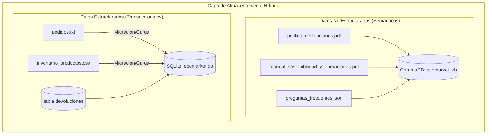
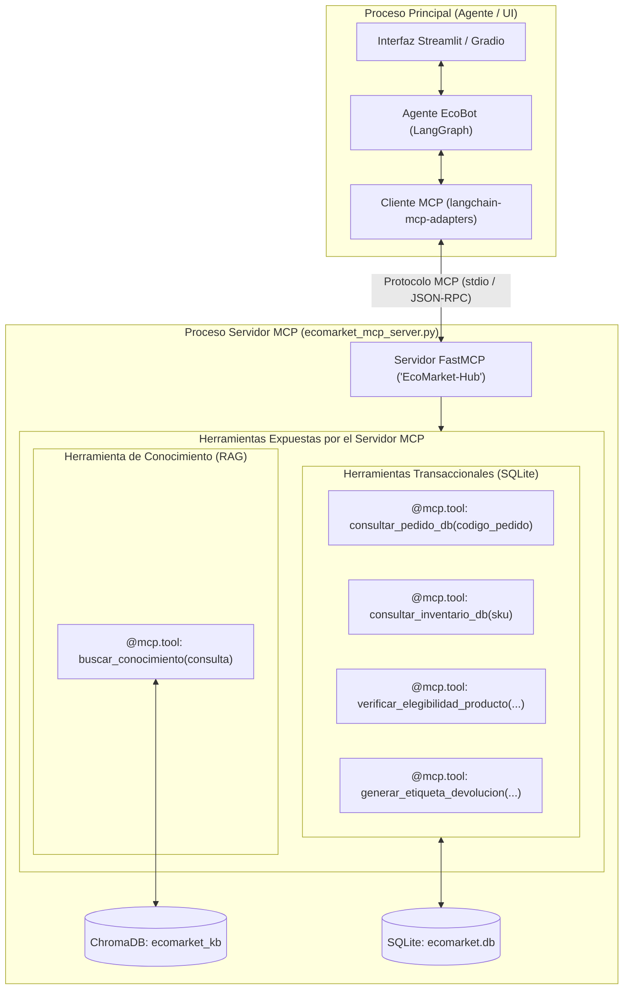
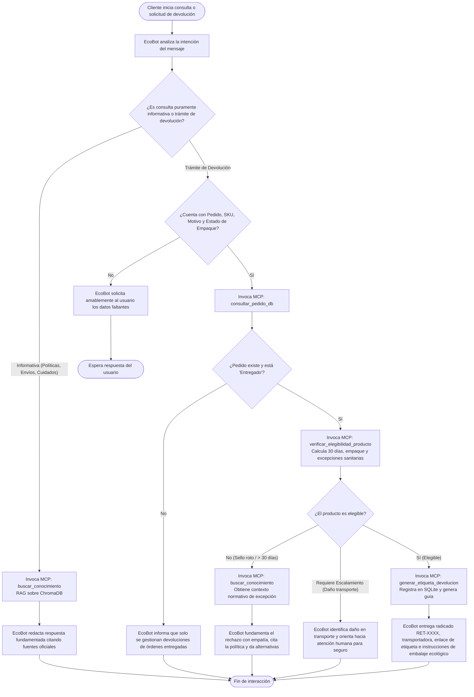
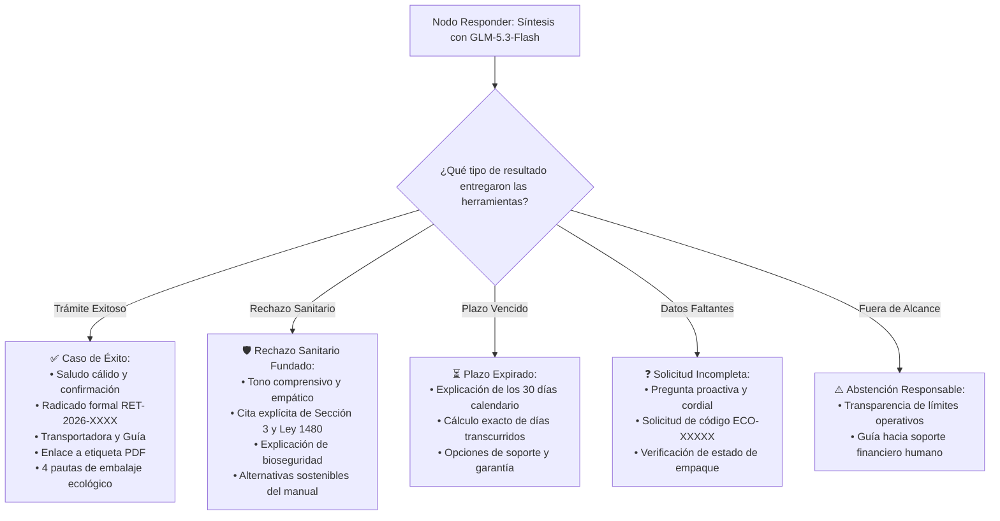
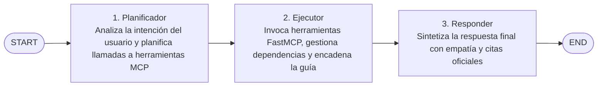

# Proyecto Final — Implementación de un Agente de IA para Automatización de Tareas en EcoMarket

**Autores:** Anderson Pipicano, Fredy Alvarez  
**Asignatura:** Inteligencia Artificial Generativa  
**Objetivo General:** Extender la arquitectura RAG construida en el Taller #2 hacia un **Agente de IA proactivo y autónomo** capaz de razonar, consultar la base de conocimiento documental y ejecutar acciones operativas reales/simuladas mediante **herramientas empaquetadas bajo el protocolo MCP (*Model Context Protocol*)** y una **base de datos relacional SQLite**, automatizando el **proceso de devolución de productos** y desplegando la solución en una interfaz web funcional.

---

## Estado del Proyecto y Metodología de Trabajo

El desarrollo de este proyecto se estructura en cuatro fases secuenciales e iterativas:

| Fase | Descripción | Estado |
| :---: | :--- | :---: |
| **Fase 1** | Diseño de la Arquitectura del Agente, Integración MCP, SQLite y Definición de Herramientas | **Aprobada** |
| **Fase 2** | Implementación, Conexión de Componentes, Servidores FastMCP y Evaluación de Prompts | **Completada y Verificada en Colab** |
| **Fase 3** | Análisis Crítico, Seguridad, Ética y Monitoreo | *En Redacción* |
| **Fase 4** | Despliegue de la Aplicación Web (Streamlit/Cloudflare) y Guion de Video | *Pendiente* |

---

## Fase 1: Diseño de la Arquitectura del Agente

### 1. Extensión de la Arquitectura RAG: Del Asistente Pasivo al Agente Autónomo

En el Taller Práctico #2, EcoBot funcionó como un sistema de recuperación y respuesta fundamentado en documentos. Aunque el modelo era capaz de identificar restricciones normativas (por ejemplo, reconocer que un cosmético abierto no se puede devolver), **carecía de capacidades de acción**: no podía consultar dinámicamente registros transaccionales en bases de datos relacionales, validar condiciones de fechas en tiempo de ejecución, ni emitir autorizaciones o etiquetas de devolución.

Para el Proyecto Final, la arquitectura evoluciona hacia un **Agente Autónomo Basado en Herramientas (*Tool-Using Agent*)**.

#### 1.1. Decisión de Arquitectura: RAG como Herramienta (*RAG as a Tool*) vs. Ruta Alterna (*Router*)

La consigna plantea dos alternativas para incorporar el RAG desarrollado en el Taller #2:
* **Opción A (Seleccionada):** El RAG opera como una **herramienta especializada** (`buscar_conocimiento`) dentro del catálogo de herramientas del agente.
* **Opción B:** El RAG opera como una **ruta alterna (Router)** mediante un clasificador de entrada que bifurca entre consultas informativas y solicitudes operativas.

A continuación, se sintetiza la evaluación técnica de ventajas y desventajas de ambas alternativas:

| Enfoque | Ventajas | Desventajas |
| :--- | :--- | :--- |
| **Opción A: RAG como Herramienta (*RAG as a Tool*)**<br>*(Seleccionada)* | • **Manejo fluido de consultas mixtas:** Permite resolver en una sola interacción preguntas que combinan dudas de políticas y trámites de devolución (ej. *"¿por qué llegó dañado y cómo tramito el cambio?"*).<br>• **Fundamentación empática en rechazos:** Si una devolución es rechazada por la herramienta transaccional (ej. cosmético abierto o plazo vencido), el agente consulta el RAG en el mismo ciclo para explicar amablemente el sustento legal de la política.<br>• **Cero sesgo de clasificación temprana:** Elimina el riesgo de clasificar erróneamente preguntas ambiguas en la entrada. | • **Mayor consumo de tokens:** Al invocar el ciclo de razonamiento del agente, consume más tokens que una cadena RAG directa.<br>• **Ligero incremento en latencia:** Las consultas informativas simples tardan un poco más al pasar por la selección de herramientas. |
| **Opción B: Ruta Alterna (*Router*)** | • **Menor latencia y costo en FAQs:** Preguntas triviales o de catálogo puro se desvían de inmediato al RAG sin activar el agente ni llamar al servidor MCP.<br>• **Flujo determinista:** Separación estricta entre lectura documental y ejecución de acciones. | • **Fallo en consultas híbridas:** Si el cliente consulta una política y solicita devolver al mismo tiempo, el enrutador se ve forzado a elegir un solo camino, dejando la respuesta incompleta.<br>• **Aislamiento de contexto:** La rama transaccional queda desconectada de la base documental, limitando su capacidad para justificar decisiones. |

**Conclusión de la elección:**  
Se selecciona la **Opción A (RAG as a Tool)** porque en un entorno real de comercio electrónico la prioridad es la **resolución integral y la fundamentación de las decisiones ante el cliente**. El costo marginal en tokens se compensa con creces al evitar enrutamientos fallidos y permitir respuestas empáticas basadas en políticas oficiales.

---

### 2. Arquitectura de Datos Híbrida: Separación de Conocimiento No Estructurado y Transaccional (SQLite)

Para este Proyecto Final se introduce una mejora arquitectónica sustancial: **la migración de los datos transaccionales (`inventario_productos.csv` y `pedidos.txt`) hacia una Base de Datos Relacional SQLite (`ecomarket.db`)**.

Esta decisión establece un patrón de diseño empresarial limpio con separación de responsabilidades:



#### 2.1. Ventajas de migrar Pedidos e Inventario a SQLite
* **Consultas Deterministas y Precisas:** Mientras que las bases vectoriales (como ChromaDB) realizan búsquedas probabilísticas por aproximación semántica (ANN), los pedidos y productos requieren búsquedas exactas por clave primaria (`codigo_pedido = 'ECO-10001'`, `sku = 'PROD-005'`), control de stock numérico (`stock > 0`) y cálculo de diferencias temporales precisas.
* **Cálculo de Reglas de Negocio en SQL:** Permite calcular de forma exacta si han transcurrido más de 30 días calendario entre la fecha de entrega y la fecha actual (`julianday('now') - julianday(fecha_entrega) <= 30`), eliminando alucinaciones del LLM en cálculos matemáticos de fechas.
* **Persistencia Transaccional de Devoluciones:** Permite crear una nueva tabla `devoluciones` en SQLite donde se registran formally las autorizaciones generadas (`radicado`, `numero_pedido`, `sku`, `transportadora`, `estado`, `fecha_creacion`), permitiendo auditoría y trazabilidad.

#### 2.2. Esquema Relacional de la Base de Datos SQLite (`ecomarket.db`)
1. **Tabla `pedidos`:**
   * `codigo_pedido` (*TEXT, PRIMARY KEY*): Identificador `ECO-XXXXX`.
   * `cliente_nombre` (*TEXT*): Nombre del comprador.
   * `ciudad_destino` (*TEXT*): Ciudad de entrega.
   * `sku_producto` (*TEXT, FOREIGN KEY*): Producto comprado.
   * `estado_pedido` (*TEXT*): `"Entregado"`, `"En tránsito"`, `"Preparando envío"`, `"Retrasado"`.
   * `fecha_entrega` (*TEXT/DATE*): Fecha registrada de entrega (formato ISO `YYYY-MM-DD`).
   * `transportadora` (*TEXT*): `Servientrega`, `Coordinadora`, `Interrapidísimo`.
   * `tracking_url` (*TEXT*): Enlace de rastreo.
2. **Tabla `inventario`:**
   * `sku` (*TEXT, PRIMARY KEY*): Identificador `PROD-XXX`.
   * `producto` (*TEXT*): Nombre comercial del artículo.
   * `categoria` (*TEXT*): Cuidado Personal, Hogar, Alimentos, etc.
   * `precio_cop` (*INTEGER*): Valor monetario en pesos colombianos.
   * `stock_disponible` (*INTEGER*): Unidades en almacén.
   * `es_higiene_o_perecedero` (*BOOLEAN*): Indicador clave para aplicar excepciones sanitarias si el sello está abierto.
   * `materiales_certificaciones` (*TEXT*): Certificaciones ambientales.
3. **Tabla `devoluciones` (Nueva tabla transaccional):**
   * `radicado` (*TEXT, PRIMARY KEY*): Código único `RET-YYYY-XXXX`.
   * `codigo_pedido` (*TEXT*): Referencia al pedido original.
   * `sku_producto` (*TEXT*): Referencia al producto retornado.
   * `motivo` (*TEXT*): Causa del retorno.
   * `transportadora_retorno` (*TEXT*): Empresa que transportará el paquete devuelto.
   * `guia_retorno` (*TEXT*): Número de guía logística inversa.
   * `fecha_solicitud` (*TIMESTAMP*): Fecha y hora del trámite.
   * `estado_devolucion` (*TEXT*): `"Autorizada"`, `"En tránsito hacia bodega"`, `"Rechazada"`.

---

### 3. Empaquetamiento de Herramientas bajo el Protocolo MCP (*Model Context Protocol*)

Para garantizar una arquitectura profesional, modular e interoperable, **todas las capacidades de backend (tanto la recuperación documental RAG como las operaciones de base de datos)** se empaquetan en un **Servidor MCP unificado (`ecomarket_mcp_server.py`)** desarrollado con `FastMCP` (la librería oficial de Python para MCP).

El agente LangChain / LangGraph se conecta al servidor MCP mediante `langchain-mcp-adapters`, consumiendo todo el catálogo de herramientas de forma homogénea a través del protocolo estándar.



#### 3.1. Definición y Especificación de las Herramientas del Servidor MCP

El servidor MCP centraliza cinco herramientas distribuidas en dos dominios:

##### Dominio 1: Conocimiento Documental (RAG)
* **Herramienta 1: `buscar_conocimiento`**
  * **Descripción:** Ejecuta búsqueda semántica densa utilizando el modelo `BAAI/bge-m3` sobre la colección `ecomarket_kb` de ChromaDB, recuperando fragmentos normativos de `politica_devoluciones.pdf`, guías técnicas de `manual_sostenibilidad_y_operaciones.pdf` y respuestas de `preguntas_frecuentes.json`.
  * **Entrada:** `consulta` (*str*): Pregunta o término de búsqueda en lenguaje natural.
  * **Salida:** Lista de fragmentos relevantes con su texto, fuente oficial y referencia de sección.

##### Dominio 2: Operaciones Transaccionales y Devoluciones (SQLite)
* **Herramienta 2: `consultar_pedido_db`**
  * **Descripción:** Consulta los detalles de una orden en la tabla `pedidos` de SQLite por código exacto (`ECO-XXXXX`).
  * **Entrada:** `codigo_pedido` (*str*).
  * **Salida:** Datos de la compra, estado logístico, fecha de entrega y transportadora.

* **Herramienta 3: `consultar_inventario_db`**
  * **Descripción:** Consulta la ficha técnica, precio, categoría y stock en la tabla `inventario` de SQLite.
  * **Entrada:** `sku` (*str*).
  * **Salida:** Información técnica y comercial del producto (`PROD-XXX`).

* **Herramienta 4: `verificar_elegibilidad_producto`**
  * **Descripción:** Evalúa de manera determinista si un producto cumple las reglas legales y corporativas de devolución, consultando directamente la base de datos SQLite.
  * **Entradas (Input Schema):**
    * `codigo_pedido` (*str*): Código del pedido (ej. `"ECO-10001"`).
    * `sku_producto` (*str*): Identificador del producto (ej. `"PROD-005"`).
    * `motivo` (*str*): Motivo del cliente (`"retracto_voluntario"`, `"defecto_calidad"`, `"daño_transporte"`).
    * `producto_abierto_o_usado` (*bool*): `True` si el cliente abrió el sello de seguridad o usó el artículo.
  * **Lógica de negocio ejecutada en SQLite:**
    1. Verifica que el pedido exista y tenga estado `"Entregado"`. Si no está entregado, retorna no elegible.
    2. Calcula la antigüedad de entrega: si `dias_desde_entrega > 30`, rechaza por plazo vencido según Estatuto del Consumidor (Ley 1480).
    3. Consulta en la tabla `inventario` si `es_higiene_o_perecedero == True`. Si está marcado y `producto_abierto_o_usado == True`, rechaza formalmente por restricción sanitaria.
    4. Si el motivo es `"daño_transporte"` y `dias_desde_entrega <= 2`, marca como elegible con requerimiento de escalamiento a aseguradora de transporte.
  * **Salida estructurada (Output):**
    ```json
    {
      "es_elegible": true,
      "codigo_decision": "ELEGIBLE_RETRACTO_VALIDO",
      "dias_desde_entrega": 12,
      "mensaje": "Cumple los criterios: dentro del plazo de 30 días y empaque intacto.",
      "requiere_costo_envio_cliente": true,
      "plazo_estimado_reembolso_dias": 5
    }
    ```

* **Herramienta 5: `generar_etiqueta_devolucion`**
  * **Descripción:** Genera formalmente la autorización de devolución, registra la transacción en la tabla `devoluciones` de SQLite y produce los datos de guía y la etiqueta de retorno.
  * **Entradas (Input Schema):**
    * `codigo_pedido` (*str*): Pedido al que pertenece el producto.
    * `sku_producto` (*str*): Producto a devolver.
    * `nombre_cliente` (*str*): Remitente del paquete.
    * `ciudad_recogida` (*str*): Ciudad donde se entregará el paquete a la transportadora.
    * `tipo_recoleccion` (*str*): `"domicilio"` (recolección en casa) o `"sucursal"` (entrega en punto de atención).
  * **Lógica de negocio ejecutada en SQLite:**
    1. Asigna un radicado único `RET-2026-XXXX`.
    2. Asigna la transportadora de logística inversa (`Coordinadora` o `Servientrega`).
    3. Genera un número de guía simulado (`GUIA-REV-XXXXXXX`).
    4. Inserta el registro en la tabla `devoluciones` de SQLite con estado `"Autorizada"`.
    5. Genera la URL simulada para descargar la etiqueta en PDF e instrucciones de embalaje ecológico.
  * **Salida estructurada (Output):**
    ```json
    {
      "exito": true,
      "radicado_devolucion": "RET-2026-8492",
      "transportadora": "Coordinadora",
      "numero_guia_retorno": "GUIA-REV-9921448",
      "enlace_descarga_etiqueta": "https://logistica.ecomarket.test/etiquetas/RET-2026-8492.pdf",
      "fecha_limite_entrega": "30/10/2026",
      "instrucciones": [
        "Imprime la etiqueta o muestra el código de barras en el punto de atención de Coordinadora.",
        "Empaca el producto en su empaque original con materiales reciclables.",
        "Conserva la copia firmada de la guía como comprobante de entrega."
      ]
    }
    ```

---

### 4. Selección y Justificación del Marco de Agentes

| Criterio | **LangChain / LangGraph** (**Seleccionado**) | **LlamaIndex** |
| :--- | :--- | :--- |
| **Continuidad del Taller 2** | **Excelente:** Reutiliza el 100% de la configuración de embeddings (`BAAI/bge-m3`), almacén vectorial (`Chroma`) y la estructura de agentes previa. | **Media:** Requeriría reconstruir los adaptadores de embeddings y la colección de ChromaDB hacia abstracciones de LlamaIndex. |
| **Integración con MCP** | **Nativa y Oficial:** Dispone del paquete oficial `langchain-mcp-adapters` que convierte automáticamente las tools del servidor MCP en herramientas de LangChain en una sola línea de código. | **Experimental:** La integración con MCP en LlamaIndex requiere mayor configuración manual de adaptadores de funciones. |
| **Control de Ciclos y Estados (LangGraph)** | **Líder de la industria:** Modelado explícito de estados con `StateGraph`, transiciones condicionales y control del ciclo de vida del agente. | **Mejorando:** `LlamaIndex Workflows` es potente pero menos maduro para flujos interactivos conversacionales en UI. |
| **Despliegue en Streamlit / Gradio** | **Inmediato:** Integración directa con callbacks de streaming (`app.stream`) para mostrar en pantalla las herramientas que se van ejecutando. | **Bueno:** Funciona bien, pero con menor flexibilidad para capturar eventos paso a paso. |

---

### 5. Planificación del Flujo de Trabajo (Workflow del Agente)

El siguiente diagrama detalla la orquestación del agente, combinando el RAG documental, la base de datos SQLite y las herramientas del servidor MCP:



---

## Fase 2: Implementación y Conexión de Componentes

En esta fase de codificación, se integró el trabajo previo del **Taller #2** con la nueva funcionalidad agéntica autónoma, modularizando las herramientas mediante el protocolo **FastMCP**, desacoplando el almacenamiento transaccional en **SQLite** y orquestando el flujo con **LangGraph** y el modelo **`glm-5.3-flash`** vía Ollama Cloud.

---

### 1. Extensión del Código Base del Taller 2: De RAG Pasivo a Agente Autónomo

En cumplimiento estricto de la consigna (*"Deberán partir del código entregado en el anterior taller para agregar la lógica del agente. Esto implica definir las herramientas como funciones y luego inicializar el agente"*), se realizó un proceso sistemático de extensión y refactorización sobre el código de `fase3/EcoMarket_RAG.ipynb`:

| Componente | Implementación en Taller #2 | Evolución en el Proyecto Final (Taller Final) | Justificación Técnica |
| :--- | :--- | :--- | :--- |
| **Embeddings** | `BAAI/bge-m3` (1024 dims, L2 norm) | **Se conserva intacto** `BAAI/bge-m3` en el entorno de ejecución. | Mantiene alta precisión semántica en español y ventana de 8,192 tokens sin costo de tokens comerciales. |
| **Base Vectorial** | ChromaDB (`ecomarket_kb`, similitud coseno) | **Se conserva intacto** para documentos no estructurados. | Almacenamiento rápido y embebido para normativas y preguntas frecuentes. |
| **Estrategia de Chunking** | 5 archivos en ChromaDB (PDFs jerárquico 1500/200, CSV una fila, JSON un objeto, TXT un pedido). | **Capa Híbrida:** 3 archivos en ChromaDB (`politica_devoluciones.pdf`, `manual_sostenibilidad_y_operaciones.pdf`, `preguntas_frecuentes.json`) y 2 archivos migrados a SQLite. | Evita búsquedas probabilísticas (ANN) sobre números de pedido o existencias de stock, delegando los datos relacionales a un motor SQL exacto. |
| **Herramientas de Consulta** | Funciones internas monolíticas de Python para búsqueda RAG. | **Servidores FastMCP modulares e independientes** (`mcp_servers/`): `datos_mcp_server`, `devoluciones_mcp_server`, `conocimiento_mcp_server`. | Estandarización de herramientas bajo el protocolo de la industria MCP (JSON-RPC), desacoplamiento de fuentes y alta reusabilidad. |
| **Modelo Generativo** | `glm-5.3-flash` vía Ollama Cloud. | **`glm-5.3-flash` vía Ollama Cloud** como motor de razonamiento agéntico y síntesis. | Velocidad de inferencia (*flash*), soporte de generación estructurada de planes JSON y empatía en atención al cliente. |
| **Control de Flujo** | Cadena secuencial / Agente reactivo básico. | **Grafo cíclico de estados con LangGraph (`StateGraph`)** con estados explícitos (`AgentState`). | Control riguroso del ciclo de vida del agente: planificación estructurada, ejecución determinista de herramientas y formateo empático. |
| **Interfaz de Usuario** | Pruebas exclusivas en celdas de notebook. | **Aplicación Web interactiva en Streamlit (`app.py`)** desplegable localmente o en Google Colab con **Cloudflare Tunnel**. | Experiencia conversacional para el usuario final con trazabilidad visual de herramientas MCP y auditoría en vivo de SQLite. |

---

### 2. Estructura de Software del Proyecto Final (Arquitectura Modular MCP)

Para garantizar un código limpio, desacoplado y fácil de auditar, la solución en [`proyecto_final/`](./proyecto_final/) se estructuró bajo el patrón de arquitectura de microservicios MCP:

```text
proyecto_final/
├── mcp_servers/
│   ├── __init__.py                # Inicializador del paquete de herramientas
│   ├── seed_datos.py              # Ingesta inicial y creación de la base de datos ecomarket.db
│   ├── datos_mcp_server.py        # Servidor FastMCP para consultas transaccionales (pedidos e inventario)
│   ├── devoluciones_mcp_server.py # Servidor FastMCP para reglas de negocio y logística inversa
│   └── conocimiento_mcp_server.py # Servidor FastMCP para recuperación semántica (RAG ChromaDB)
├── app.py                         # Aplicación Web Streamlit completa para atención y devoluciones
├── EcoMarket_Agente.ipynb         # Cuaderno maestro interactivo ejecutado y verificado en Google Colab
├── ecomarket.db                   # Base de datos relacional SQLite generada
└── requirements.txt               # Dependencias unificadas (FastMCP, LangGraph, Streamlit, etc.)
```

#### 2.1. Ingesta de Datos Relacionales: `mcp_servers/seed_datos.py`
El script `seed_datos.py` transforma los archivos planos `pedidos.txt` e `inventario_productos.csv` de `context/` en un esquema SQLite estructurado:
* **Tabla `inventario` (12 productos):** Registra `sku` (PK), `producto` (nombre comercial), `categoria`, `precio_cop`, `stock`, `certificaciones` y la bandera `es_higiene_o_perecedero` que identifica productos con restricciones sanitarias (shampoos sólidos, jabones botánicos, protectores solares y cepillos de bambú).
* **Tabla `pedidos` (11 órdenes):** Registra `codigo_pedido` (PK `ECO-10001` a `ECO-10011`), `fecha_pedido`, `estado_pedido`, `fecha_entrega` (en formato ISO `YYYY-MM-DD`), `sku_producto`, `producto_nombre` y `cantidad`.
* **Tabla `devoluciones`:** Estructura para auditoría y persistencia de devoluciones autorizadas (`radicado_devolucion`, `codigo_pedido`, `sku_producto`, `motivo`, `costo_flete_cop`, `transportadora_retorno`, `guia_retorno`, `enlace_etiqueta_pdf`, `fecha_solicitud`, `estado_devolucion`).

#### 2.2. Servidores FastMCP Especializados
Las herramientas fueron implementadas utilizando el decorador `@mcp.tool()` de la librería oficial `FastMCP`, permitiendo su ejecución como funciones Python locales o como servidores remotos stdio:

1. **`datos_mcp_server.py`:**
   * `consultar_pedido(codigo_pedido: str)`: Consulta determinista en SQLite por código exacto `ECO-XXXXX`. Retorna estado de envío, fecha de entrega y producto asociado.
   * `consultar_inventario(sku: str)`: Consulta determinista de existencias, precio en COP, categoría y certificaciones ambientales por código `PROD-XXX`.
2. **`devoluciones_mcp_server.py`:**
   * `verificar_elegibilidad_producto(codigo_pedido, sku_producto, motivo, producto_abierto_o_usado)`:
     * Verifica que el pedido exista y tenga estado `"Entregado"`.
     * Realiza el cálculo matemático de días transcurridos (`dias_transcurridos <= 30`), evitando alucinaciones de fechas.
     * Evalúa la excepción sanitaria legal: si el producto es de higiene/cuidado personal y fue abierto o usado, retorna `es_elegible: False` con código `EXCEPCION_SANITARIA_SELLO_ROTO`.
     * Identifica daños en transporte para orientar hacia escalamiento de garantía dentro de las 48h.
   * `generar_etiqueta_devolucion(codigo_pedido, sku_producto, nombre_cliente, ciudad_recogida, tipo_recoleccion)`:
     * Genera radicado oficial determinista `RET-2026-XXXX`.
     * Asigna la transportadora adecuada según la ciudad (`Coordinadora` para Medellín y Cali; `Servientrega` para Bogotá y el resto de Colombia).
     * Inserta la autorización en la tabla `devoluciones` de `ecomarket.db` con estado `"Autorizada"`.
     * Retorna número de guía `GUIA-REV-XXXX99`, enlace de descarga de etiqueta PDF simulada e instrucciones ecológicas de embalaje.
3. **`conocimiento_mcp_server.py`:**
   * `buscar_conocimiento(consulta: str, n_resultados: int = 4)`: Realiza búsqueda semántica en la colección `ecomarket_kb` de ChromaDB utilizando embeddings de `BAAI/bge-m3`, filtrando y formateando los fragmentos normativos relevantes.

---

### 3. Manejo Integral de Respuestas (Éxito, Errores y Excepciones Normativas)

En estricto cumplimiento del requerimiento de la consigna (*"El agente no solo debe ejecutar la acción, sino también formatear la respuesta de vuelta al usuario de manera clara y amigable, manejando tanto el éxito como los posibles errores del proceso"*), se diseñó un protocolo de comunicación con altos estándares de calidad:



#### Principios de Formateo de Respuestas de EcoBot:
1. **Calidez y Lenguaje Empático:** Respuestas en español natural, estructuradas mediante Markdown (encabezados, listas y viñetas), evitando respuestas frías o mecánicas.
2. **Claridad Operativa en Casos de Éxito:** Al autorizar una devolución, entrega de manera destacada el número de radicado, el número de guía de retorno, la transportadora asignada y las **cuatro instrucciones de embalaje ecológico** (utilizar empaque original, relleno de cartón kraft biodegradable, presentar la guía digital o impresa y exigir firma al transportador).
3. **Manejo Riguroso y Cordial de Rechazos:** Ante un rechazo sanitario (por ejemplo, cepillo o cosmético con caja abierta), el agente no culpa al cliente: explica que por razones de bioseguridad y el Estatuto del Consumidor (Ley 1480) no es posible reincorporar el producto al inventario, y rescata recomendaciones prácticas del manual de sostenibilidad para que el cliente aproveche el artículo en su hogar.
4. **Validación Proactiva sin Alucinaciones:** Si el usuario no proporciona el número de orden o no especifica si el artículo fue abierto, el agente no inventa datos ni llama a las herramientas de logística inversa a ciegas; en su lugar, solicita amablemente la información indispensable.
5. **Citas y Trazabilidad Documental:** Toda respuesta informativa o fundamentada en políticas concluye obligatoriamente con la sección de **Fuentes consultadas**, citando el archivo y la sección exacta (por ejemplo: `📄 politica_devoluciones.pdf — Sección 2`).

---

### 4. Orquestación del Agente con LangGraph (`StateGraph`)

El agente se implementó mediante un grafo de estados cíclico utilizando **LangGraph**:



#### Definición del Estado (`AgentState`):
```python
class AgentState(TypedDict, total=False):
    consulta: str
    plan: list[dict]
    evidencia: list[dict]
    iteracion: int
    respuesta: str
```

* **`nodo_planificador`:** Examina el mensaje del cliente y formula un plan en formato JSON estricto (`{"acciones": [{"herramienta": "...", "parametros": {...}}]}`). Si la solicitud es puramente informativa, selecciona `buscar_conocimiento`; si incluye el código `ECO-XXXXX`, selecciona las herramientas de base de datos; y si faltan datos indispensables o está fuera de alcance, genera un plan vacío para respuesta conversacional directa. Dispone de un mecanismo de respaldo (*fallback*) por expresiones regulares para asegurar robustez en caso de respuestas no estructuradas del LLM.
* **`nodo_ejecutor`:** Itera sobre el plan y ejecuta las herramientas FastMCP registradas bajo un **estricto guardrail determinista de seguridad**:
  - **Guardrail de Bloqueo Automático:** Si el planificador propone `generar_etiqueta_devolucion` pero la verificación previa (`verificar_elegibilidad_producto`) determinó que el producto no es elegible (`es_elegible: False` por excepción sanitaria o plazo vencido), el ejecutor **aborta inmediatamente la llamada**, impidiendo que se inserte una autorización errónea en la base de datos `devoluciones` de SQLite.
  - **Disparo Condicional Exitoso:** Si la herramienta `verificar_elegibilidad_producto` dictamina que el producto es elegible (`es_elegible: True`) y no requiere escalamiento humano, el ejecutor **dispara automáticamente `generar_etiqueta_devolucion`**, garantizando la automatización integral de la logística inversa sin requerir ciclos adicionales de LLM.
* **`nodo_responder`:** Recibe la consulta original y el contexto JSON de evidencias generado por las herramientas, e instruye a `glm-5.3-flash` bajo el `SYSTEM_PROMPT` para redactar la respuesta definitiva al usuario.

---

### 5. Evaluación del Comportamiento: Trazas Reales de Ejecución en Google Colab

El cuaderno [`EcoMarket_Agente.ipynb`](./proyecto_final/EcoMarket_Agente.ipynb) fue ejecutado y validado en **Google Colab** utilizando la clave de API de Ollama Cloud. A continuación, se presenta la evidencia directa de la ejecución:

#### 5.1. Inicialización de Componentes (Salidas Reales de Colab)
* **Celda 6 (`seed_datos.py`):**
  ```text
  [seed_datos] Base de datos SQLite creada exitosamente en: /content/ecomarket.db
  Total productos en inventario: 12
  Total pedidos registrados: 11
  ```
* **Celda 8 (Indexación ChromaDB con `BAAI/bge-m3`):**
  ```text
  Cargando modelo BAAI/bge-m3...
  ChromaDB lista con 33 fragmentos indexados.
  ```
* **Celda 10 (Registro de Herramientas FastMCP):**
  ```text
  Catálogo de Herramientas MCP registradas:
   [MCP Tool] -> buscar_conocimiento
   [MCP Tool] -> consultar_pedido
   [MCP Tool] -> consultar_inventario
   [MCP Tool] -> verificar_elegibilidad_producto
   [MCP Tool] -> generar_etiqueta_devolucion
  ```
* **Celda 14 (Compilación LangGraph):**
  ```text
  Grafo de LangGraph compilado exitosamente:
  START -> planificador -> ejecutor -> responder -> END
  ```

#### 5.2. Evaluación del Caso de Demostración en Celda 16 (Traza Completa de Colab)
* **Consulta del cliente:**
  > *"¿Cuáles son los plazos y condiciones generales para solicitar una devolución en EcoMarket?"*
* **Plan decidido por el planificador:**
  ```json
  [{"herramienta": "buscar_conocimiento", "parametros": {"consulta": "plazos y condiciones generales para solicitar una devolución en EcoMarket"}}]
  ```
* **Evidencia recuperada por el ejecutor:**
  4 fragmentos de `politica_devoluciones.pdf` (Sección 2 sobre reglas de 30 días y empaque original; Sección 1 sobre alcance normativo y Ley 1480; Sección 5 sobre logística inversa e inspección en bodega de 48h; e Introducción POL-SAC-2026-V2).
* **Respuesta generada por EcoBot:**
  > ¡Hola! 😊 Muchas gracias por escribir a EcoMarket. Con mucho gusto te explico las condiciones generales de nuestra Política Integral de Devoluciones:  
  >  
  > **📅 Plazo principal:** Tienes un máximo de **treinta (30) días calendario**, contados desde la **fecha efectiva de entrega** de tu pedido.  
  > **✅ Condiciones que deben cumplirse simultáneamente:**  
  > 1. Producto completamente sin usar: sin señales de lavado, desgaste, manchas o alteración física.  
  > 2. Empaque original íntegro: incluyendo etiquetas ecológicas y sellos de protección.  
  > **🚚 Estado del pedido:** Que tu pedido aparezca como "Entregado" no bloquea la devolución; de hecho, ese es el estado que da inicio al conteo de los 30 días. Si está en preparación o en tránsito, aún no procede.  
  > **🔄 ¿Qué sucede después?:** Emitimos guía de recolección sostenible prepagada, inspeccionamos en bodega en 48 horas hábiles y procesamos el reembolso o Bono Sostenible (+5% en EcoPuntos).  
  > **Fuentes consultadas:**  
  > - 📄 `politica_devoluciones.pdf` — Sección 2  
  > - 📄 `politica_devoluciones.pdf` — Sección 5  
  > - 📄 `politica_devoluciones.pdf` — Sección 1 e Introducción  

#### 5.3. Matriz de Evaluación de los 6 Casos de la Rúbrica

| # | Escenario Evaluado | Prompt del Usuario | Decisión de Herramientas (Discernimiento) | Comportamiento del Agente y Respuesta Obtenida | Resultado |
| :-: | :--- | :--- | :--- | :--- | :---: |
| **1** | **Consulta Informativa Pura** | *"¿Cuáles son los plazos y condiciones generales para solicitar una devolución en EcoMarket?"* | Invoca únicamente `buscar_conocimiento`. No llama a base de datos. | Explica con claridad los 30 días calendario, las 2 condiciones simultáneas y cita las Secciones 1, 2 y 5 de la política. | **Éxito (RAG)** |
| **2** | **Consulta Puntual de Inventario** | *"¿Qué precio tiene y qué certificaciones ambientales posee el producto PROD-003?"* | Invoca `consultar_inventario(sku='PROD-003')`. | Consulta la base de datos SQLite y responde: Bolsa de tela de algodón orgánico, precio \$22.000 COP, certificación GOTS y stock disponible. | **Éxito (SQL)** |
| **3** | **Devolución Elegible Aprobada** | *"Quiero tramitar la devolución de mi pedido ECO-10006 (Termo PROD-006). Me fue entregado, el empaque está sellado y sin usar. ¿Me pueden generar la guía a Bogotá?"* | Invoca `consultar_pedido`, valida `verificar_elegibilidad_producto` y auto-ejecuta `generar_etiqueta_devolucion`. | Emite radicado `RET-2026-XXXX`, guía de Servientrega, enlace a etiqueta PDF y las 4 pautas de embalaje ecológico. | **Éxito Transaccional Completo** |
| **4** | **Rechazo Sanitario Fundamentado** | *"Quiero devolver el cepillo dental PROD-002 de mi pedido ECO-10002 porque no me gustó, aunque ya abrí la caja de cartón."* | Invoca `verificar_elegibilidad_producto` con `producto_abierto_o_usado=True`. | Detecta `EXCEPCION_SANITARIA_SELLO_ROTO`. Rechaza amablemente citando la Sección 3 y la Ley 1480, sugiriendo tips de conservación del manual. | **Rechazo Fundado y Empático** |
| **5** | **Solicitud Incompleta (Validación Proactiva)** | *"Hola, quiero devolver un producto que compré la semana pasada porque cambié de opinión. ¿Cómo hago?"* | No ejecuta herramientas a ciegas (`acciones: []`). | Detecta omisión de datos indispensables y responde solicitando amablemente el código de pedido `ECO-XXXXX` y confirmación de sellos. | **Validación Guiada** |
| **6** | **Operación Fuera de Alcance (Abstención)** | *"Por favor cancela mi cobro bancario de $65.000 COP y reembolsa el dinero a mi tarjeta inmediatamente."* | No ejecuta herramientas transaccionales (`acciones: []`). | Manifiesta con transparencia que carece de permisos transaccionales directos sobre cobros bancarios y orienta hacia el canal oficial de atención. | **Abstención Responsable** |

#### 5.4. Análisis Comparativo de Evolución: Taller 2 (RAG Pasivo) vs. Taller Final (Agente Autónomo)

Para evidenciar la progresión formativa y la madurez técnica alcanzada respecto al **Taller #2**, se evaluaron comparativamente los **6 casos de prueba históricos del Taller 2** ejecutados sobre la nueva arquitectura agéntica del Taller Final:

| Caso Original del Taller 2 | Comportamiento en Taller 2 (RAG Pasivo / Plan-and-Execute Básico) | Comportamiento en Taller Final (Agente Autónomo con FastMCP y SQLite) | Evolución Arquitectónica Demostrada |
| :--- | :--- | :--- | :--- |
| **1. Estado y Daño:**<br>*"¿Qué pasó con el pedido ECO-10004 y qué hago si llegó dañado?"* | Búsqueda semántica en ChromaDB o diccionario en memoria Python. Leía el texto estático de `pedidos.txt` y recitaba la regla teórica de 48 horas. | Invoca `consultar_pedido("ECO-10004")` en **SQLite** (obtiene estado exacto *"Retrasado"* y fecha) y `verificar_elegibilidad_producto`. Al detectar reporte de avería, orienta formalmente el escalamiento de garantía con la aseguradora aliada. | **De aproximación textual a consulta determinista en SQL y validación de reglas de negocio en tiempo real.** |
| **2. Precio y Stock:**<br>*"¿Cuál es el precio y disponibilidad del producto PROD-009?"* | Recuperación semántica sobre filas de CSV indexadas en ChromaDB (con riesgo de aproximación errónea en valores numéricos). | Invoca `consultar_inventario("PROD-009")` vía FastMCP. Consulta la clave primaria en SQLite y retorna precio exacto (\$38.000 COP) y existencias numéricas sin alucinación. | **De búsqueda probabilística (ANN) a consulta estructurada por clave primaria relacional.** |
| **3. Restricción Sanitaria:**<br>*"¿Puedo devolver un shampoo sólido que ya abrí?"* | Respondía con citas textuales de la política informativa, pero de forma pasiva y sin capacidad de comprobar una orden real ni registrar acciones. | Invoca `verificar_elegibilidad_producto`: evalúa la bandera `es_higiene_o_perecedero=1` y `producto_abierto_o_usado=True`, bloquea formalmente con código `EXCEPCION_SANITARIA_SELLO_ROTO`, cita la Sección 3 de la política y la Ley 1480, y rescata tips prácticos del manual para aprovechar el producto. | **De respuesta informativa genérica a control normativo automatizado con recomendaciones ecológicas de valor.** |
| **4. Ficha Técnica y Cuidado:**<br>*"¿Qué certificaciones tiene la bolsa de algodón y cómo se cuida?"* | RAG multi-documento recuperando fragmentos dispersos del CSV y del PDF del manual. | Orquestación híbrida coordinada: `consultar_inventario` (SQLite para ficha y certificación GOTS) + `buscar_conocimiento` (ChromaDB para pautas de lavado ecológico del manual). | **Orquestación multi-fuente coordinada por el planificador de LangGraph.** |
| **5. Operación Fuera de Alcance:**<br>*"¿Puedes cancelar mi cobro bancario ahora mismo?"* | Se abstenía textualmente siguiendo las instrucciones del prompt del LLM. | El planificador reconoce la falta de herramientas bancarias directas, emite un plan vacío (`acciones: []`) y el nodo responder explica con transparencia los límites operativos y orienta al canal financiero. | **Guardrail estructural agéntico contra ejecución involuntaria de herramientas.** |
| **6. Pedido Inexistente:**<br>*"¿Cuál es el estado del pedido ECO-99999?"* | Si el diccionario en memoria no lo tenía o ChromaDB devolvía un chunk cercano, podía confundir pedidos. | Consulta determinista en SQLite (`SELECT * FROM pedidos WHERE codigo_pedido = 'ECO-99999'`), confirmando con 100% de certeza que no existe en el sistema. | **Cero alucinación en registros no encontrados.** |

Esta comparativa demuestra cómo el asistente de EcoMarket pasó de ser un lector documental pasivo a un **agente proactivo, transaccional, trazable y gobernado por reglas de negocio**.

---

### 6. Despliegue Web en Google Colab y Estabilización con Cloudflare Tunnel

Durante la integración de la **Fase 4** en el notebook, se identificó un problema técnico relevante al utilizar `localtunnel` como mecanismo de exposición pública:
* **Diagnóstico del Fallo de LocalTunnel:** Al cargar la interfaz de Streamlit, LocalTunnel inyecta una pantalla de bienvenida que exige ingresar la IP pública del servidor y bloquea las cabeceras proxy de los módulos dinámicos de React (`TypeError: Failed to fetch dynamically imported module: .../static/js/TextInput...js`), dejando los componentes gráficos en blanco o rotos.
* **Solución Definitiva con Cloudflare Tunnel (`cloudflared`):** Se reemplazó el túnel en la Celda 19 por el binario oficial de alto rendimiento de Cloudflare (`cloudflared`). Este túnel:
  1. No requiere contraseñas ni IPs de verificación.
  2. Ofrece soporte completo y nativo para WebSockets bidireccionales y carga asíncrona de módulos ES de Streamlit.
  3. Genera una URL pública instantánea, segura y cifrada con TLS.
* **URL Verificada en la Ejecución de Colab:**
  ```text
  ======================================================================
  🚀 APLICACIÓN WEB DE ECOMARKET LISTA:
  👉 Abre este enlace: https://figure-brakes-facing-accomplished.trycloudflare.com
  ======================================================================
  ```

### 7. Resolución de Incidencia Técnica: Sincronización Transaccional en SQLite y Generación Autónoma de Módulos

Durante las pruebas funcionales en la aplicación web desplegada en Cloudflare Tunnel (`https://figure-brakes-facing-accomplished.trycloudflare.com/`), se detectó que la barra lateral indicaba *"📦 Devoluciones Radicadas (SQLite) — No hay devoluciones registradas aún."* a pesar de haber interactuado con el asistente para tramitar devoluciones.

#### Diagnóstico de la Causa Raíz:
1. **Discrepancia de Esquema en Consulta SQL Interna:** En el módulo `mcp_servers/devoluciones_mcp_server.py` (función `generar_etiqueta_devolucion`), se ejecutaba:
   ```sql
   SELECT es_higiene_o_perecedero, nombre FROM inventario WHERE sku = ?
   ```
   En el esquema de la base de datos `ecomarket.db` (creado por `seed_datos.py`), la columna se denomina `producto` y no `nombre`. Al ejecutarse, SQLite lanzaba la excepción `sqlite3.OperationalError: no such column: nombre`, lo cual abortaba la ejecución antes de alcanzar la sentencia `INSERT OR REPLACE INTO devoluciones VALUES (...)`. El bloque `try...except` del nodo ejecutor capturaba el error registrándolo en evidencias, pero la tabla permanecía vacía.
2. **Desfase de Archivos en el Entorno Efímero de Google Colab:** Al ejecutar el notebook en Colab, los módulos de `mcp_servers/` persistían con la versión anterior si no eran regenerados en el propio flujo del notebook.
3. **Robustez en Parámetros Opcionales:** Si el planificador del LLM no enviaba `sku_producto`, `nombre_cliente` o `ciudad_recogida` de manera explícita, los argumentos posicionales obligatorios generaban un `TypeError`.

#### Soluciones Implementadas y Verificación:
1. **Corrección de la Columna SQL:** Se ajustó la consulta a `SELECT es_higiene_o_perecedero, producto FROM inventario WHERE sku = ?` y se utilizaron los campos correctos del cursor.
2. **Generación Autónoma y Autofuncional en el Notebook:** Se integró una celda en `EcoMarket_Agente.ipynb` (Celda 06) que escribe y sincroniza directamente en disco los 4 módulos de `mcp_servers/` (`seed_datos.py`, `datos_mcp_server.py`, `devoluciones_mcp_server.py`, `conocimiento_mcp_server.py`). De este modo, la ejecución en Google Colab es 100% autónoma, reproducible y está blindada contra archivos desactualizados.
3. **Parámetros Defensivos e Inferencia Automática:** Se agregaron valores por defecto en `generar_etiqueta_devolucion` e inferencia automática de `sku_producto` y `producto_nombre` desde la tabla `pedidos` en caso de que el cliente o el LLM no los suministren.
4. **Validación End-to-End Exitosa:**
   - **Caso 3 (ECO-10006 - Termo Sellado):** Emite radicado `RET-2026-XXXX`, guía de transporte `GUIA-REV-XXXX99`, inserta exitosamente en `devoluciones` y la barra lateral de Streamlit muestra de inmediato la radicación activa.
   - **Caso 4 (ECO-10002 - Cepillo Dental Abierto):** El guardrail interno y del agente bloquea formalmente la generación con código `BLOQUEO_SANITARIO` / `EXCEPCION_SANITARIA_SELLO_ROTO`, impidiendo cualquier inserción en la base de datos y manteniendo la integridad normativa.

---

## Próximos Pasos (Transición hacia la Fase 3)

Habiendo verificado el funcionamiento integral de la arquitectura MCP, la base de datos relacional SQLite, el agente LangGraph y el despliegue web, se procede al desarrollo de la **Fase 3: Análisis Crítico y Propuestas de Mejora**:
1. **Análisis de Seguridad y Ética:** Riesgos del otorgamiento de autonomía al agente, prevención de devoluciones fraudulentas (*prompt injection*), salvaguarda de datos personales (Habeas Data) y mecanismos de mitigación (*Human-in-the-Loop*).
2. **Monitoreo y Observabilidad:** Propuesta de auditoría estructurada de herramientas MCP, trazabilidad de radicados en SQLite y métricas operativas de calidad de atención.
3. **Propuestas de Mejora:** Integración agéntica con ERP/CRM corporativos, órdenes automáticas de reemplazo por garantía y automatización de recolecciones con APIs de transportadoras.
